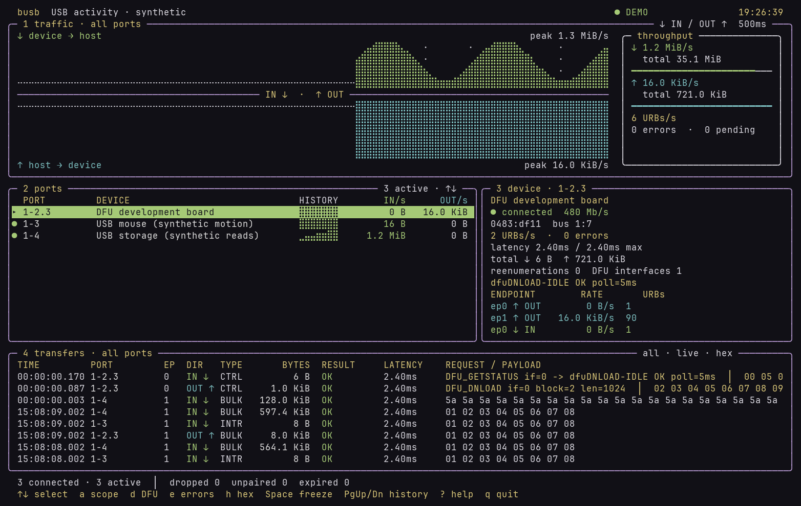

# busb

A Linux terminal USB activity monitor inspired by [btop](https://github.com/aristocratos/btop).
Watch **all USB I/O**: mouse reports, keyboard events, storage reads and writes, audio/video streams,
and control transfers. DFU protocol decoding adds context when developing firmware.

The dashboard shows rolling IN/OUT graphs, **per-port transfer rates and activity**, endpoint
rates, transfer errors, submission-to-completion latency, and captured payload hex previews.
USB IN means device → host; OUT means host → device. A `●` next to a port indicates recent activity.
Select a physical port path to follow a board through disconnects and USB address/VID:PID changes.



*Dashboard preview with synthetic USB traffic. Colors follow your terminal theme.*

## Obtain, build, and install

busb currently supports **Linux**. Download the source from
[bprendie/busb](https://github.com/bprendie/busb), or clone it with Git:

```sh
git clone https://github.com/bprendie/busb.git
cd busb
```

Requires Linux, a C++20 compiler, Make, pkg-config and the ncurses wide-character development library.

```sh
# Arch Linux / Omarchy
sudo pacman -S --needed base-devel git pkgconf ncurses

# Debian / Ubuntu
sudo apt update
sudo apt install build-essential git pkg-config libncurses-dev
```

Build, check, and install system-wide:

```sh
make -j"$(nproc)"
make test
sudo make install PREFIX=/usr/local
```

This installs `/usr/local/bin/busb`. To try it without installing, replace `busb` with
`./build/busb` in the examples below. For a user-local installation, use `make install`
and make sure `~/.local/bin` is on your PATH.

## Run

```sh
busb --demo       # Synthetic mouse, storage, and DFU activity; no root needed
busb --list       # Connected devices and physical port paths; no root needed

sudo modprobe usbmon
sudo busb         # Live traffic on every USB bus
```

Move a USB mouse, type on a USB keyboard, or read/write a USB drive: its physical port's
activity and IN/OUT rates will update. Use ↑/↓ to focus a port and `a` to return to all ports.
The usbmon module may need to be loaded again after reboot.

The live backend uses `/dev/usbmonN` and the kernel's **binary GETX API**. It does not
claim interfaces, detach drivers, or send requests to devices. Existing device applications
(including dfu-util) keep operating normally. Debugfs is not needed for this backend.

```sh
sudo ./build/busb --bus 3                  # Restrict kernel capture to bus 3
sudo ./build/busb --port 3-2.4.1            # Focus a device by physical port
sudo ./build/busb --bus 3 --record run.pcap # Record all captured bus traffic
./build/busb --replay run.pcap             # Replay with original timing
./build/busb --replay run.pcap --dfu-interface 0
sudo ./build/busb --headless --duration 10 # Summary after 10 seconds
```

`--port` and interactive filters affect the display/summary. **Recording includes every device
on the captured bus(es)**, regardless of selected port or DFU/error filters. Capture files are
created with mode 0600; existing files are never overwritten. Payloads can include input-device
reports and application data. Default captured data is limited to 4096 bytes per live event;
use `--snaplen N` (0–1048576) to change it. Byte counters use actual completed transfer lengths,
independently of payload truncation. The kernel can also limit the data it provides.

## Controls

| Key | Action |
| --- | --- |
| ↑ / ↓, j / k | Select a physical USB port and focus its traffic |
| a | Toggle selected-port / all-port graphs and transfer log |
| d | Toggle DFU-only transfer display |
| e | Toggle transfer-error display |
| h | Toggle payload hex previews |
| Space | Freeze display while capture and recording continue |
| PgUp / PgDn, Home | Browse retained transfer history / return to live |
| ? | Help |
| q | Quit |

The UI uses rounded panels, mirrored IN/OUT braille graphs, throughput meters, and per-port
sparklines on wide terminals. Colors inherit the terminal's ANSI palette, so the display follows
your terminal theme (including Omarchy themes) without a separate busb theme configuration.
Meters and sparklines use a relative scale; numeric rates show measured bytes per second.
The UI needs at least 80×24 cells, adapts on resize, and uses more room in taller terminals.
Rates sample every 500 ms; graphs keep 90 seconds. The log retains 2000 events, each port
retains 128, and outstanding request correlation is bounded to 65536 requests/60 seconds.
The status line reports kernel drops, callbacks without matching submissions, expired pending
requests, and the latest connect/disconnect/re-enumeration event. A capture started with a
request already in flight will naturally have some unmatched callbacks.

## What the numbers mean

Transfer rates count bytes reported by **URB callbacks**, once per completion; requested bytes
on submissions are not added. Errors include failed callbacks and submission errors. Pending
interrupt requests on an idle mouse are normal. Per-port activity indicators and URBs/s also
show transfers that complete with zero data. Successful OUT callbacks use their submission's
payload for the hex preview because the data normally appears only on submission.

Throughput scales through B/s, KiB/s, MiB/s, and GiB/s. The advertised link speed in device details
is separate from measured I/O throughput. These are **host USB transfer bytes**, so audio/video
and storage protocol overhead may differ from an application's useful data rate. An optical
drive must be attached over USB to appear here.

The [Linux usbmon documentation](https://docs.kernel.org/usb/usbmon.html) describes the capture
layer: requests between device drivers and host controller drivers. This is not an electrical
USB protocol analyzer: individual wire packets, ACK/NAK retries, voltage and link signaling
are not visible. Kernel-reported drops mean the observed rates and counts can be incomplete.

## DFU and reconnects

DFU interfaces are discovered from sysfs class `fe`, subclass `01`. Standard DFU requests
are decoded with interface/block numbers; GETSTATUS responses show state, DFU error status,
and the 24-bit polling timeout. Vendor-specific bootloaders may need their own future decoder.
Use `--dfu-interface N` to explicitly identify a nonstandard or replayed interface. Class
requests on unrelated interfaces are not automatically labeled DFU.

The selection follows a **Linux sysfs physical port path**, not a USB address or serial number.
Counters remain attached to that port even if a different device is plugged into it. USB2/USB3
companion buses can use different paths. Topology is sampled every 500 ms; resets shorter than
that may escape lifecycle detection. Transfers seen before a new device is discovered appear
under `busN:ADDRESS`; root-hub traffic also appears under these unresolved rows.

## Saved captures

Recording uses classic pcap with LINKTYPE_USB_LINUX_MMAPPED (220), readable by Wireshark.
Replay currently accepts native-endian, microsecond-resolution pcap files of that link type.
Replay uses saved bus/address identities and never associates old traffic with today's devices.
Pcap does not save sysfs names/port paths/DFU interface metadata: replay rows use `busN:ADDRESS`,
and DFU decoding needs `--dfu-interface`. End of file stays visible in the UI; headless replay
exits. UI timestamps show UTC time of day (demo timestamps are elapsed synthetic time).

## Update and uninstall

```sh
git pull --ff-only
make -j"$(nproc)"
make test
sudo make install PREFIX=/usr/local
```

Remove the system-wide installation with `sudo rm /usr/local/bin/busb`, or remove
`~/.local/bin/busb` if you chose a user-local installation.

## Troubleshooting

- **Cannot open /dev/usbmon0:** run `sudo modprobe usbmon`, then launch with `sudo busb`.
  The kernel must support USB monitoring (`CONFIG_USB_MON`).
- **sudo: busb: command not found:** use `sudo /usr/local/bin/busb`, or the full path to
  your user-local binary. Some sudo configurations use a separate PATH.
- **No activity from a built-in keyboard, touchpad, or drive:** only USB devices are visible.
  Internal devices may use I²C, PS/2, SATA, or NVMe instead; Bluetooth reports appear as
  traffic on the USB Bluetooth adapter, when that adapter is USB-connected.
- **No space for the dashboard:** use at least an 80×24 terminal. A larger terminal shows
  more device details, endpoint counters, and payload data. Use a UTF-8 locale and a font
  with braille/box-drawing support for the graphs.
- **Dropped events:** capture a single bus with `--bus N`, reduce payload capture with
  `--snaplen N`, and check the drop counter when interpreting rates.

## License

MIT. See [LICENSE](LICENSE).

## Design reference

Reviewed btop's `src/btop.cpp` collection/draw runner, `src/btop_shared.hpp` collectors, and
`src/btop_draw.hpp` graph/meter interfaces at commit `4792b0700e617cb2ee5ffbced50c1e52528b912a`.
busb uses the same useful separation of capture/model/rendering and a panel-based dashboard,
implemented independently in C++20/ncurses. It is not a btop fork and contains no copied btop source.
DFU decoding follows the [USB DFU 1.1 specification](https://www.usb.org/sites/default/files/DFU_1.1.pdf).
